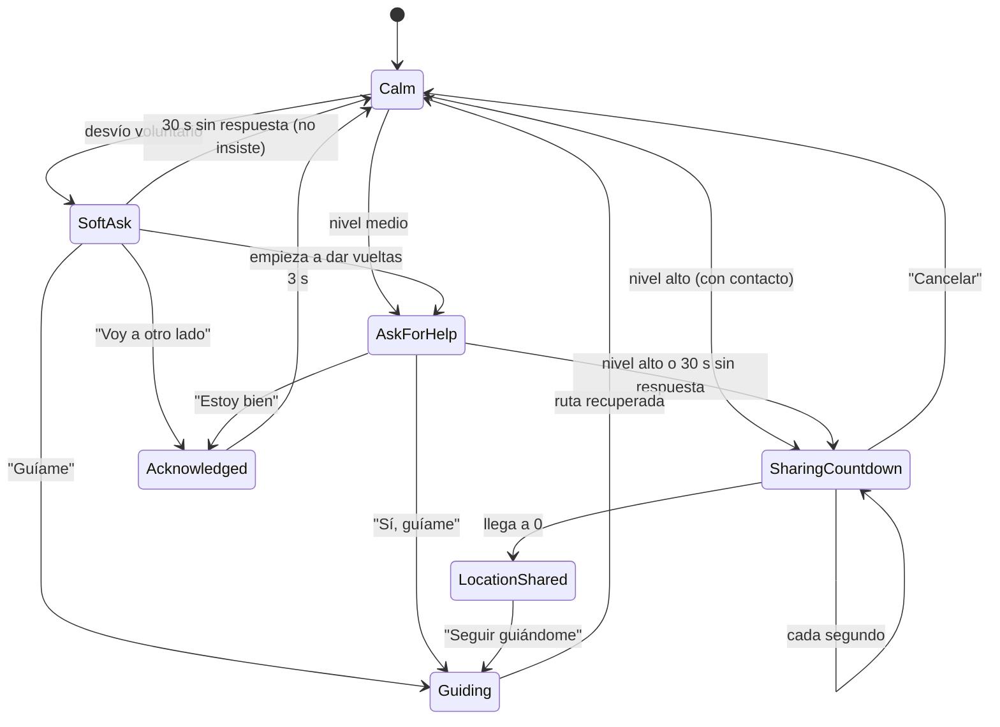

# ADR 003 — Máquina de estados explícita para la escalada de ayuda

- **Estado**: aceptada
- **Fecha**: 2026-10-18

## Contexto

La ayuda escala: preguntar suave → preguntar → guiar → cuenta regresiva → avisar al contacto, y vuelve a la calma cuando el usuario responde o recupera su ruta. Si esta lógica se reparte entre pantallas y `if`s, aparecen estados imposibles (por ejemplo, avisar a Laura mientras el usuario ya dijo "Estoy bien").

## Decisión

- **Patrón State**: `AssistanceState` es un `sealed interface` (`Calm`, `SoftAsk`, `AskForHelp`, `Guiding`, `SharingCountdown`, `LocationShared`, `Acknowledged`).
- `AssistanceStateMachine.next(state, event)` es **pura**: sin efectos, sin tiempo, sin Android.
- **Cadena de responsabilidad** para decidir la acción ante una detección: `VibrateAndAskLink` → `AlternativeRouteLink` → `ShareLocationLink`.
- El tiempo vive fuera: `AssistanceTimers` (15 s, 30 s, 1 s, 3 s) envía eventos.
- Los efectos observan las transiciones (`TripSession.transitions`): háptica (`AssistanceHapticPolicy`), métricas, aprendizaje y aviso al contacto.

## Consecuencias

- ✅ Cada transición tiene su prueba (`AssistanceStateMachineTest`) y los tiempos se prueban con tiempo virtual (`AssistanceTimersTest`).
- ✅ Los estados imposibles no se pueden representar.
- ✅ Agregar un estado obliga al compilador a revisar todos los `when`.
- ⚠️ Decisiones explícitas que antes quedaban implícitas: cancelar la cuenta vuelve a Calm; nivel alto sin contacto pregunta en vez de compartir; mientras guía, nuevas lecturas no interrumpen.
