# Simplificación de la interfaz

Auditoría hecha el 25 de octubre sobre el emulador **Wear OS Large Round (454 × 454)** con la app en español.
Las capturas de antes están en `docs/capturas/antes/` y las de después en `docs/capturas/despues/`.

Se siguió el orden de los PDF del curso: **contenido → jerarquía → estructura → estilo**.

## Reglas aplicadas

| Regla | Cómo se mide |
|---|---|
| Una idea por pantalla | 1 mensaje principal + 1 dato de apoyo + 1 acción primaria (y como mucho 1 secundaria). |
| Pocos gráficos | Máximo 2 elementos gráficos a la vez (anillo/arco, mapa, icono grande, flecha). |
| Textos cortos | Títulos de 3–4 palabras; frases de 8–10 palabras como máximo. |
| Revelación progresiva | Lo explicativo pasa a un segundo nivel ("Toca para saber más"). |
| Sin repeticiones | La misma información no aparece en dos sitios de la pantalla. |
| Zona segura | Nada cortado por el borde redondo; si no cabe, se quita, no se encoge. |
| Estado accesible | Color + icono + texto + vibración, pero **en un solo chip** (`LostChip`). |

## Hallazgos en el emulador (antes)

1. **Permiso de ubicación** (`02`): el texto se cortaba con "…" ("Tus datos se…") y el botón tocaba el borde.
2. **Alerta "¿Necesitas ayuda?"** (`07`): "Estoy bien" quedaba fuera de la pantalla redonda; había que desplazar para ver la segunda respuesta. Además la explicación aparecía dos veces (arriba como contexto y abajo como frase).
3. **Inicio en recorrido** (`06`): 8 elementos (icono, estado, hora, icono de lugar, destino, progreso, 2 botones); el progreso "0 de 13 min" repetía lo que ya muestra el anillo.
4. **Monitoreo** (`11`): arco + chip + mapa + titular + "Lo que noto hoy" + filas de razones + botón; el titular quedaba cortado por debajo.
5. **Guía** (`08`): "Volver a tu ruta de siempre" arriba y "hacia tu ruta de siempre" abajo decían lo mismo.
6. **Tu semana** (`17`): número, letras de los días, frase resumen y 4 métricas con meta: más de 12 líneas en una pantalla de reloj.

## Pantalla por pantalla

| Pantalla | Había | Se quita | Pasa a segundo nivel | Queda (principal · apoyo · acción) | Por qué |
|---|---|---|---|---|---|
| **Bienvenida** | Título, frase de 14 palabras, puntos, botón | Media frase | — | "Hola, soy LOST" · frase de 8 palabras · Empezar | Leer de un vistazo. |
| **Permiso de ubicación** | Icono, pregunta, frase de 15 palabras (cortada con "…"), 2 botones (el segundo bajo el borde) | Icono decorativo, media frase | — | "¿Usamos tu ubicación?" · "Así aprendo tus recorridos, que se quedan en tu reloj." · Permitir / Ahora no | El texto se cortaba y "Ahora no" no se veía. |
| **Contacto** | Pregunta, fila "Laura · Hermana", botón "Elegir a Laura", nota | La fila (hacía lo mismo que el botón) | — | Pregunta · Elegir a Laura · "Puedes quitarlo cuando quieras." | Dos controles para la misma acción. |
| **Inicio (reposo)** | Anillo, icono, título, frase, 2 botones | Atajo "Demostración" (ya está en Ajustes y chocaba con el indicador de sección) | — | "LOST está atento" · "Camina y reconoceré tu recorrido." · Empezar recorrido | Una sola acción. |
| **Inicio (recorrido)** | Anillo, icono, estado, hora, icono de lugar, destino, progreso, 2 botones | Icono suelto, icono de lugar, "0 de 13 min" (ya lo dice el anillo), "Toca para saber por qué" | El detalle: tocar el chip de estado abre Monitoreo | Chip de estado (tocable) · hora de llegada · "Llegas a Casa → U" · Terminar recorrido | 8 → 4 elementos. |
| **Monitoreo** | Arco, chip, mapa, titular largo (cortado), "Lo que noto hoy", filas de razones, botón | Arco de probabilidad, encabezado, filas de razones, botón | Las razones: tocar el chip abre "¿Por qué te pregunto?" | Chip · **mapa real** a pantalla completa · titular de 3–4 palabras | 2 gráficos (mapa + chip); el mapa es la idea. |
| **Explicación** | Encabezado, frase, 2 iconos sueltos | Iconos sin texto | — | "¿Por qué te pregunto?" · frase humana | La frase ya lo dice. |
| **Pregunta suave** | Arco, icono, pregunta, 2 botones (el segundo cortado por el borde) | — | — | "¿Vas a otro lado hoy?" · Sí, voy a otro lado / Guíame | Ahora caben las dos respuestas. |
| **¿Necesitas ayuda?** | Arco, icono grande, contexto de 2 líneas, pregunta, 2 botones, frase de explicación repetida | La frase repetida | La explicación completa, en Monitoreo | "Te saliste de tu ruta." · ¿Necesitas ayuda? · Sí, guíame / Estoy bien | "Estoy bien" se cortaba; ahora todo cabe sin desplazar. |
| **Guía** | Arco, título, flecha, distancia, minutos, "hacia tu ruta de siempre" | La línea final (repetía el título) | — | "Vuelve a tu ruta" · flecha (con brújula) + distancia · minutos | Nada repetido. |
| **Cuenta regresiva / aviso enviado / Entendido** | — | — | — | Sin cambios | Ya tenían una sola idea. |
| **Aprendiendo tu rutina** | Anillo, icono, "4 de 5", "Hemos visto este recorrido 4 veces", "Una más y…", botón | "Hemos visto… 4 veces" (repetía "4 de 5") | — | "4 de 5" · "Una más y la guardamos" · Guardar | Nada repetido. |
| **Detalle de rutina** | Mapa, título, horario, hasta 3 botones | "Renombrar" mientras no está guardada | — | **Mapa real** · "Casa → U" · horario · Guardar o Renombrar / Borrar | Como mucho 1 primaria + 1 secundaria. |
| **Lugar nuevo** | Chip, icono, destino, frase de 14 palabras, botón | Icono de lugar | — | Chip · destino · "Te aviso si das vueltas por aquí." · aviso de privacidad · Empezar | 2 gráficos; el aviso dice qué sale del reloj. |
| **Tu semana** | Anillo, encabezado, "0 de 5", letras de días, frase resumen, 4 métricas con meta | Letras de los días (el anillo ya tiene un segmento por día), frase larga | Las 4 métricas → pantalla **Métricas** | "Tu semana" · "3 de 5 días" · "6 recorridos · 1 rutina" · Ver métricas | De más de 12 líneas a 4 elementos. |
| **Ajustes** | 7 filas (incluía "Tu semana") | "Tu semana" (estaba en dos sitios) | — | Sensibilidad · Vibración · Texto grande · **Mapa real** · Idioma · Privacidad · Demostración · **Acerca de** | Sin entradas duplicadas. |
| **Privacidad** | 2 frases (una cortada), mantener para borrar | — | — | Tres frases cortas y verdaderas (incluye qué pide el mapa) · Borrar lo aprendido | Honestidad sobre lo que sale del reloj. |
| **Contactos, Destinos, Mis recorridos, Demostración** | Listas | — | — | Sin cambios de estructura (Destinos suma "Lugares encontrados") | Una fila = una idea. |

## Antes y después (emulador Wear OS Large Round)

| Pantalla | Antes | Después |
|---|---|---|
| Permiso de ubicación | 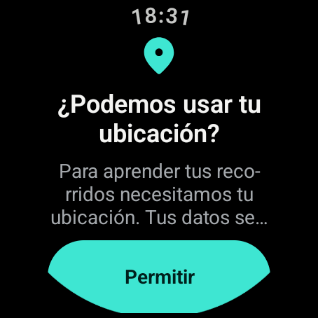 | 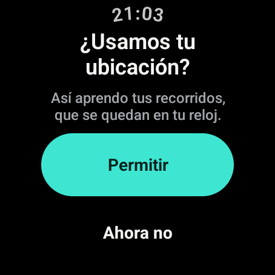 |
| Inicio en recorrido | 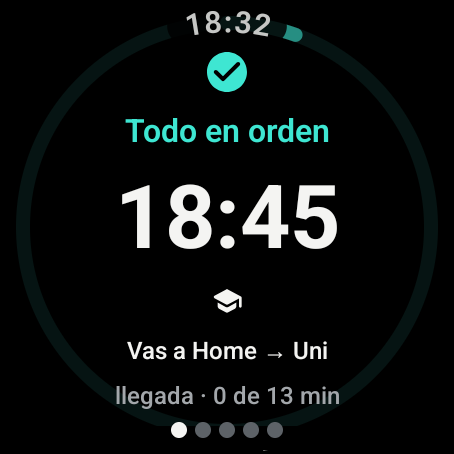 | 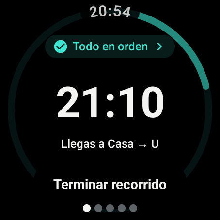 |
| ¿Necesitas ayuda? | 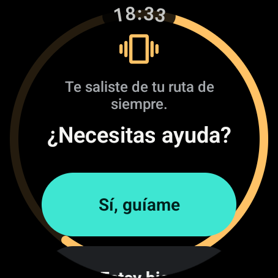 | 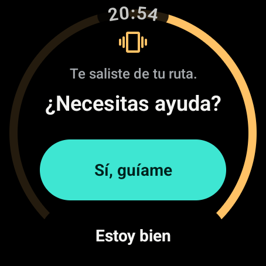 |
| Guía | 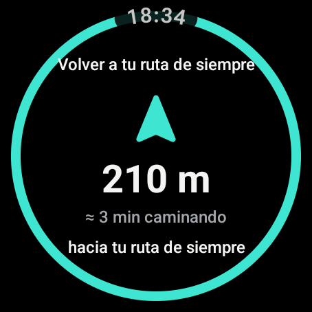 | 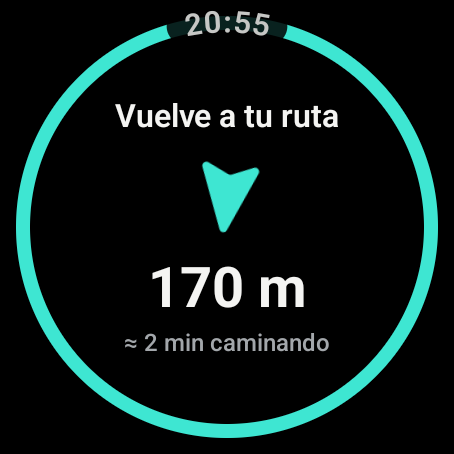 |
| Monitoreo | 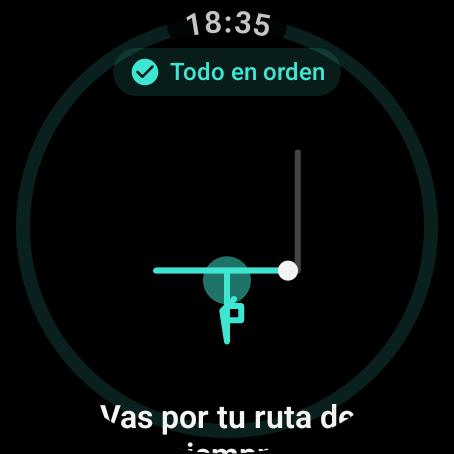 | 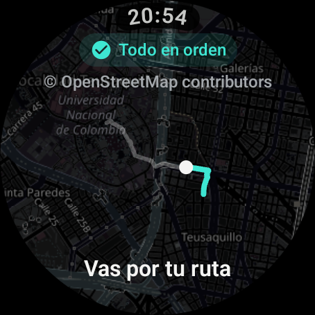 |
| Tu semana | 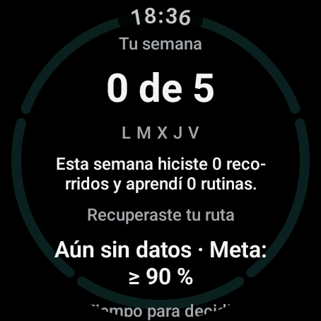 | 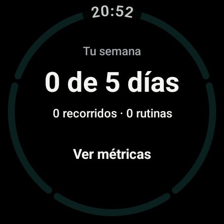 + [Métricas](../capturas/despues/17b-metricas.png) |
| Privacidad | 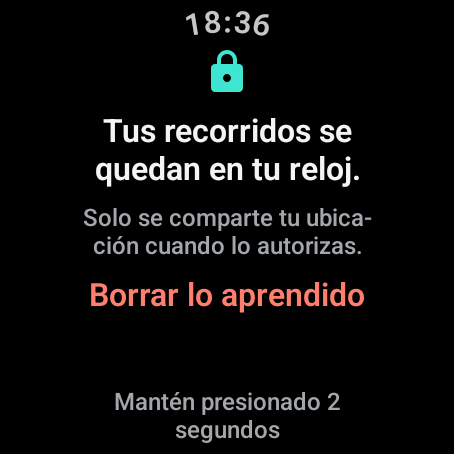 | 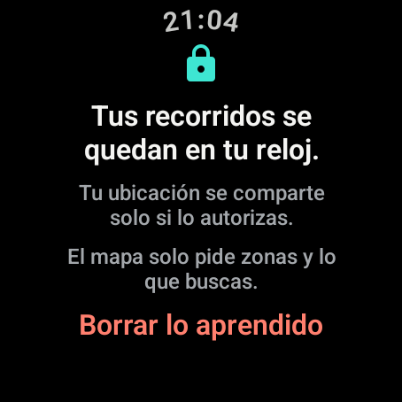 |

Las demás capturas están en `docs/capturas/antes/` y `docs/capturas/despues/` con el mismo número.

## Decisiones

- **El chip de estado es la puerta al detalle** (revelación progresiva): en Inicio abre Monitoreo y en Monitoreo abre "¿Por qué te pregunto?". Muestra una flecha "›" y ocupa un área táctil de 48 dp. Así no hace falta un botón "Toca para saber más" que ocupaba una línea entera.
- **La segunda respuesta de las alertas va solo con texto** (`DualActionButtons`). El mockup la dibuja como píldora gris, pero en el reloj redondo una píldora a todo el ancho en la parte baja choca con la curva; el área táctil sigue siendo de 52 dp y el contraste no cambia.
- **El contenido corto se centra en vertical** (`WatchScreenTemplate`): antes el desplazamiento lo pegaba arriba y las acciones caían en la curva de abajo.
- **El arco de probabilidad sale de Monitoreo, no de las alertas.** En la alerta el arco comunica la urgencia junto al icono; en Monitoreo competía con el mapa.
- **"Terminar recorrido" se queda en Inicio** (como única acción secundaria) y el detalle se abre tocando el estado.
- **Métricas en segundo nivel** (`LostDestination.Metrics`): Mis recorridos → Tu semana → Métricas, sin pasar de dos niveles bajo las secciones.
- **Sin guiones de corte** (`Hyphens.None`): en español partía mal palabras ("reco-rridos").
- **Estado compacto**: en Inicio y Monitoreo el estado es un solo `LostChip` (color + icono + texto); la vibración la sigue dando `Tone`. El estado nunca se comunica solo con color (`AccessibilityRulesTest` sigue en verde).
