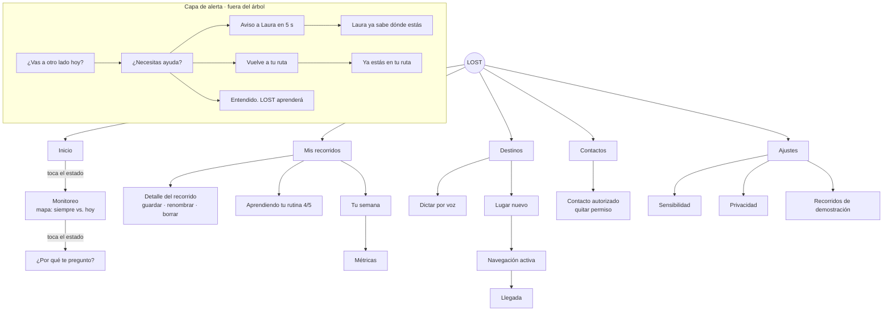

# Arquitectura de información

> PDF "Design Systems" → los 4 sistemas de la arquitectura de información. Plana a propósito: cinco secciones, nunca más de dos niveles. Las alertas no viven en el árbol: son una capa que aparece sobre cualquier pantalla.

## Diagrama

## Los 4 sistemas

| Sistema | Decisión | Dónde está en el código |
|---|---|---|
| **Organización** | 5 secciones globales: Inicio · Mis recorridos · Destinos · Contactos · Ajustes. Jerarquía plana (máximo 2 niveles). | `navigation/GlobalSection.kt`, `navigation/LostDestination.kt` |
| **Etiquetado** | Etiquetas cortas y humanas: "Inicio" (no "Dashboard"), "Mis recorridos" (no "Patrones"), "Volver" (no "Recalcular"), "Pedir ayuda" (no "SOS trigger"), "Sensibilidad" (no "Umbral de anomalía"). | `res/values*/strings.xml` (`nav_*`), `docs/contenido/glosario-voz.md` |
| **Navegación** | **Global**: pager horizontal entre secciones con indicador. **Local**: `SwipeDismissableNavHost` (deslizar a la derecha = volver). **Capa de alerta**: `AssistanceOverlay` sobre cualquier pantalla. | `navigation/SectionsPager.kt`, `navigation/LostNavHost.kt`, `feature/assistance/AssistanceOverlay.kt` |
| **Búsqueda** | Sin teclado: dictado por voz ("Llévame a…"), destinos recientes y sugeridos. | `feature/destinations/DestinationsScreen.kt`, `DestinationMatcher.kt` |

## Cambios del 25 de octubre (simplificación)

- **Revelación progresiva**: el chip de estado es la puerta al detalle (Inicio → Monitoreo → ¿Por qué te pregunto?).
- **Sin entradas duplicadas**: "Tu semana" vive solo en Mis recorridos; "Demostración" solo en Ajustes.
- **Métricas** pasan a un segundo nivel de Tu semana (`LostDestination.Metrics`).
- Detalle en `docs/diseno/simplificacion.md`.

## Por qué pager horizontal y no corona vertical

El mockup propone girar la corona o deslizar en vertical entre secciones. Pero las secciones son listas que ya usan la corona y el deslizamiento vertical para desplazarse; los dos gestos chocarían. Se usó un pager horizontal (también previsto en la sección 9.1 del plan) y la corona queda para desplazar dentro de cada sección.
