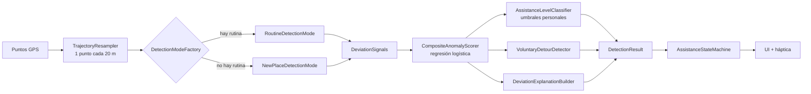

# Motor de IA de LOST

> Módulo `ai/` (Kotlin puro, sin Android). Reconocimiento de patrones, análisis de secuencias de movimiento y detección de anomalías. Compara el recorrido de hoy con la **trayectoria de referencia**, no con una distancia fija.

## Flujo



La fachada `LostDetectionEngine.evaluate(request)` esconde todo esto; el dominio solo conoce el puerto `TripEvaluator`.

## A · Aprende la rutina (reconocimiento de patrones)

- `RoutineLearner`: al terminar un recorrido, `RoutineMatcher.bestCompletedMatch` busca una rutina que salga y llegue a los mismos lugares (≤ 150 m) y cuya secuencia se parezca (DTW ≤ 60 m de costo medio).
  - Si coincide: suma una repetición, agrega el día (`EnumSet<DayOfWeek>`), promedia la hora de salida y actualiza la duración con **Welford** (`RunningStatistics`), sin guardar todas las duraciones.
  - Si no: crea una rutina nueva.
- `RoutineConfirmationPolicy`: se confirma tras **5 repeticiones** ("4 de 5" en la UI).

## B · Compara el orden (análisis de secuencias)

- `DtwSequenceComparator`: Dynamic Time Warping con **dos filas** (`DoubleArray`) y **banda de Sakoe-Chiba** → O(n·m) tiempo, O(m) memoria. Tolera caminar más rápido o más lento en un tramo.
- Versión **open-end** para recorridos en curso: compara contra el mejor prefijo de la rutina.
- `FrechetSequenceComparator` cumple el mismo contrato (`SequenceComparator`) y es intercambiable.
- `RouteProgressLocator`: en qué parte (0..1) de la ruta va el usuario.

## C · Qué no es normal (detección de anomalías)

Cada señal mide **una sola cosa** y devuelve un puntaje 0..1 y, si aplica, una razón:

| Señal | Grupo | Qué mide | Estructura de datos |
|---|---|---|---|
| `OffRouteSignal` | desvío | Distancia actual a la ruta de siempre (40 → 200 m) | proyección local |
| `SequenceDivergenceSignal` | desvío | Costo DTW open-end (25 → 150 m) | matriz DTW de 2 filas |
| `DelaySignal` | retraso | Tiempo real vs. esperado en ese punto, según sensibilidad | estadística de Welford |
| `LoopSignal` | confusión | Pasadas por la misma celda de 20 m | `HashMap<GridCell, MutableList<Int>>` |
| `ErraticHeadingSignal` | confusión | Proporción de giros > 60° por ventana | `ArrayDeque` como buffer circular |
| `MovingAwaySignal` | confusión | Cuánto creció la distancia al destino desde lo más cerca | — |
| `UnusualStopSignal` | confusión | Parada > 60 s lejos del inicio y del destino | una pasada O(n) |

## D · Cuánto preocupa (nivel de probabilidad)

```
desvío    = max(OffRoute, SequenceDivergence)
confusión = media ponderada(Loop 0.35, ErraticHeading 0.30, UnusualStop 0.25, MovingAway 0.10)
retraso   = Delay
z = b0 + w1·desvío + w2·confusión + w3·retraso + w4·(desvío·confusión)
probabilidad = sigmoid(z)
```

| Modo | b0 | w1 desvío | w2 confusión | w3 retraso | w4 interacción |
|---|---|---|---|---|---|
| Rutina | −4.0 | 1.5 | 2.0 | 1.0 | 8.0 |
| Lugar nuevo | −3.0 | 0 | 5.0 | 0 | 0 |

El término **desvío·confusión** separa el desvío voluntario (desvío alto, confusión baja → probabilidad baja) de la desorientación (ambos altos → medio/alto).

`AssistanceLevelClassifier`: probabilidad < umbral medio → **Bajo**; < umbral alto → **Medio**; si no → **Alto**. Umbrales por defecto 0.45 / 0.75, **personales**: `PersonalThresholdAdjuster` los sube con "Estoy bien" (+0.05) y los baja con una ayuda confirmada (−0.03), con límites.

`VoluntaryDetourDetector`: desvío ≥ 0.5 y "inestabilidad" (máximo de bucles, giros bruscos y paradas) < 0.2 → solo pregunta suave.

## E · Cómo ayuda (respuesta escalonada)

`AssistanceResponsePolicy` (cadena de responsabilidad): `VibrateAndAskLink` → `AlternativeRouteLink` → `ShareLocationLink`. `AssistanceStateMachine` (patrón State) — ver `docs/adr/003-maquina-de-estados.md`.

## IA explicable

`DeviationExplanationBuilder` devuelve `DeviationReason` (sealed, sin texto) de la más fuerte a la más débil. La UI lo convierte en lenguaje humano con `strings.xml` y plurales: *"Te saliste de tu ruta de siempre y pasaste 3 veces por la misma cuadra."* Nunca se muestran porcentajes.

## Pruebas

`DetectionScenariosTest` (las 5 de la sección 8.5), más pruebas de geometría, DTW/Fréchet, Welford, aprendizaje, cada señal y el puntaje. `GpxDemoEndToEndTest` corre los GPX reales por toda la tubería.
